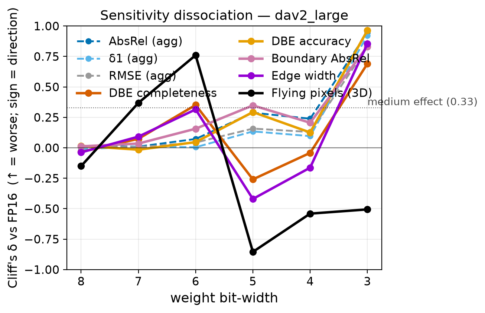

# Structural Degradation in Quantized Monocular Depth Estimation Beyond Aggregate Evaluation Metrics

Post-training quantization of monocular depth models is usually judged with aggregate error metrics (AbsRel, RMSE,
δ1), which average over the smooth majority of pixels and barely see depth discontinuities. This repository contains
the evaluation and quantization toolkit behind the paper of the same title. It evaluates Depth Anything V2 (Small,
Base, Large), DPT (Large, Hybrid) and ZoeDepth under weight-only fake quantization on iBims-1, DIODE and NYUv2, scores
every prediction with aggregate, boundary (Depth Boundary Error, edge width, band AbsRel) and structural (flying-pixel)
metrics, and compares each quantized model with full precision through paired per-image statistics. It also contains
the component ablation, the head-protection mitigation, the boundary-sensitivity-guided bit allocator (S2Q), the GPTQ,
group-wise, weight-and-activation and real-INT8 comparisons, the per-image result tables behind every reported effect
size, and the scripts that rebuild every table and data figure of the paper from those tables.



*Cliff's δ against full precision (positive = worse) across weight bit-width, Depth Anything V2 Large on iBims-1
(paper Fig. 2). At six bits the boundary and flying-pixel lines cross the medium-effect level while the aggregate
lines stay near zero.*

## Key results

From the paper; every value is regenerated by `python make_tables.py` (Depth Anything V2 Large on iBims-1 unless
stated; Cliff's δ against full precision, positive = worse).

| Result | Value | Paper |
|---|---|---|
| Six-bit weights, aggregate AbsRel / RMSE δ | 0.07 / 0.04 | Table 3 |
| Six-bit weights, DBE-completeness / edge-width / flying-pixel δ | 0.35 / 0.32 / 0.76 | Table 5 |
| Dissociation Index at seven / six bits | 0.36 / 0.67 | Table 6 |
| DBE-completeness (px): FP16 / uniform W6 / head-protected W6 | 13.93 / 30.22 / 14.31 | Table 11 |
| Memory overhead of head protection over uniform W6 | 0.17% (Base 0.16%) | Table 10 |
| Six bits, round-to-nearest vs GPTQ: AbsRel δ | 0.073 vs 0.003 | Table 17 |
| Six bits, round-to-nearest vs GPTQ: DBE-completeness δ | 0.379 vs 0.020 | Table 17 |
| DIODE indoors, six bits: AbsRel / DBE-completeness δ | 0.027 / 0.206 | Table 16 |
| Six-bit average, DBE-completeness δ: uniform / aggregate-guided / S2Q / head-protect | 0.378 / 0.080 / 0.026 / 0.006 | Table 15 |
| Real W8A8 kernels vs FP16: DBE-completeness δ | −0.015 | Table 22 |

## Installation

Python 3.12 on Linux. The analysis path (tests, tables, figures, statistics from the shipped results) runs on the CPU:

```bash
python3.12 -m venv .venv
.venv/bin/pip install -r requirements-cpu.lock
```

`requirements-cpu.lock` is the `pip freeze` of a clean venv built from `requirements-cpu.in` (CPU build of torch
2.11.0). Inference, quantized sweeps and kernel benchmarks need a CUDA GPU; `requirements-gpu.lock` is the freeze of the
environment that produced the inference results (CUDA 12.8 build of torch 2.11.0, transformers 5.14.1, torchao 0.18.0;
an RTX 5060 8 GB was used):

```bash
python3.12 -m venv .venv-gpu
.venv-gpu/bin/pip install -r requirements-gpu.lock
```

Paths default to `datasets/`, `cache/`, `results/` and `figures/` inside the repository and can be moved with
`DQ_DATA`, `DQ_CACHE`, `DQ_RESULTS` and `DQ_FIGURES` (`common.py`).

## Data

No dataset file ships with this repository (see `NOTICE`). Download each dataset from its authors and place it as
below; `checksums/datasets.sha256` lists the archives used for the paper.

| Dataset | Source | Used for | Expected layout |
|---|---|---|---|
| iBims-1 (100 images, laser ground truth, edge annotations) | https://www.asg.ed.tum.de/lmf/ibims1/ | all boundary results | `datasets/ibims/**/<scene>_<nn>.mat` |
| NYU Depth V2, official 654-image test split | https://cs.nyu.edu/~fergus/datasets/nyu_depth_v2.html | aggregate-only checks (Sec. 4.3, 11.2) | `datasets/nyu/extracted/val/official/*.h5` |
| DIODE, indoor validation split (325 images) | https://diode-dataset.org/ | second sharp-ground-truth dataset (Table 16) | `datasets/diode/val/indoors/scene_*/scan_*/` |

**iBims-1.** The project page links the data on mediaTUM (https://mediatum.ub.tum.de/1455541, web download at
https://dataserv.ub.tum.de/index.php/s/m1455541). Download `ibims1_core_mat.zip` and unpack it:

```bash
mkdir -p datasets/ibims && unzip -q ibims1_core_mat.zip -d datasets/ibims/   # -> datasets/ibims/ibims1_core_mat/*.mat
```

**NYU Depth V2.** The test split is read from the HDF5 files (RGB and depth in meters, one file per test image) of
the 654-image official split, as mirrored in the Hugging Face dataset `sayakpaul/nyu_depth_v2`:

```bash
mkdir -p datasets/nyu/extracted
for i in 0 1; do
  curl -L -o datasets/nyu/val-00000$i.tar \
    https://huggingface.co/datasets/sayakpaul/nyu_depth_v2/resolve/main/data/val-00000$i.tar
  tar -xf datasets/nyu/val-00000$i.tar -C datasets/nyu/extracted        # -> extracted/val/official/*.h5
done
```

**DIODE.** Download the depth validation archive (2.6 GB, MD5 `5c895d09201b88973c8fe4552a67dd85` as published by the
authors) and unpack it:

```bash
mkdir -p datasets/diode && curl -L -o val.tar.gz http://diode-dataset.s3.amazonaws.com/val.tar.gz
tar -xzf val.tar.gz -C datasets/diode/                                    # -> datasets/diode/val/indoors/...
```

```bash
sha256sum -c checksums/datasets.sha256     # iBims-1 and NYUv2 archives
```

## Model weights

Checkpoints are fetched from the Hugging Face Hub by `transformers` on first use (`models/registry.py`); none ships
here. Licences are those stated on the official model cards:

| Model | Checkpoint | Licence |
|---|---|---|
| Depth Anything V2 Small | `depth-anything/Depth-Anything-V2-Small-hf` | Apache-2.0 |
| Depth Anything V2 Base | `depth-anything/Depth-Anything-V2-Base-hf` | CC-BY-NC-4.0 (non-commercial) |
| Depth Anything V2 Large | `depth-anything/Depth-Anything-V2-Large-hf` | CC-BY-NC-4.0 (non-commercial) |
| DPT-Large | `Intel/dpt-large` | Apache-2.0 |
| DPT-Hybrid | `Intel/dpt-hybrid-midas` | Apache-2.0 |
| ZoeDepth | `Intel/zoedepth-nyu-kitti` | MIT |

The Base and Large Depth Anything V2 checkpoints, and any quantized model derived from them, are for non-commercial
use only.

## Reproducing the paper

Every script sets one global seed (0) for Python, NumPy and PyTorch (`common.seed_everything`), and every experiment
has one configuration file in `configs/` whose header holds the exact command. There are three levels.

**1. From the shipped results (CPU, about one minute).** Rebuilds every summary, every paper table, the in-text
numbers and the data figures, and checks them byte for byte against the shipped files:

```bash
.venv/bin/python tests/test_regenerate.py
```

or step by step:

```bash
for s in phase3_bitsweep phase3_dpt phase3_nyu_bitsweep phase4_mechanism phase6_diode_bitsweep; do
  .venv/bin/python analyze.py results/$s.csv; done           # paired statistics per sweep -> results/<sweep>_summary.csv
.venv/bin/python analyze_multimetric.py                       # Tables 3, 6
.venv/bin/python analyze_equivalence.py                       # Tables 2, 4
for s in frozen_align boundary_f_sweep flying_sensitivity flying_on_diode analyze_bands boundary_definition; do
  .venv/bin/python $s.py --from-per-image; done              # aggregates from results/per_image/
.venv/bin/python gate.py configs/gate_nyu.yaml --from-per-image   # Sec. 4.3
.venv/bin/python gptq_eval.py --rtn --from-per-image          # RTN rows of Table 17
.venv/bin/python predict_score_int8real.py --from-per-image   # Table 22 summary
.venv/bin/python make_tables.py                               # results/tables/table_NN_*.csv + in_text_numbers.json
.venv/bin/python figures.py                                   # figures/*.png
```

**2. From the prediction cache (CPU, a few minutes per script).** The sweeps cache raw predictions to
`cache/<dataset>/<model>/<precision>/<image>.npz`; the cache-based analyses rescore them without inference. Drop
`--from-per-image` above to recompute `results/per_image/*.csv` from the cache and the datasets.

**3. From scratch (GPU).** Run the sweeps (which fill the cache) and the inference experiments below.

| Paper item | Config | Command | Output |
|---|---|---|---|
| Sec. 4.3 harness check (NYUv2) | `gate_nyu.yaml` | `python gate.py configs/gate_nyu.yaml` | `results/gate_nyu.csv` |
| Sec. 4.3 harness check, DPT controls | `gate_nyu_dpt.yaml` | `python gate.py configs/gate_nyu_dpt.yaml` | `results/gate_nyu_dpt.csv` |
| Tables 3–6, Fig. 2, Sec. 5, 13 | `phase3_bitsweep.yaml` | `python run_sweep.py configs/phase3_bitsweep.yaml` | `results/phase3_bitsweep.csv` |
| Fig. 9, Sec. 11.1 | `phase3_dpt.yaml` | `python run_sweep.py configs/phase3_dpt.yaml` | `results/phase3_dpt.csv` |
| Sec. 11.2 (NYUv2) | `phase3_nyu_bitsweep.yaml` | `python run_sweep.py configs/phase3_nyu_bitsweep.yaml` | `results/phase3_nyu_bitsweep.csv` |
| Table 12, Fig. 6 | `phase4_mechanism.yaml` | `python run_sweep.py configs/phase4_mechanism.yaml` | `results/phase4_mechanism.csv` |
| Table 11, Fig. 5 | `phase4_mitigation.yaml` | `python run_sweep.py configs/phase4_mitigation.yaml` | `results/phase4_mitigation.csv` |
| Table 16 (DIODE) | `phase6_diode_bitsweep.yaml` | `python run_sweep.py configs/phase6_diode_bitsweep.yaml` | `results/phase6_diode_bitsweep.csv` |
| Tables 2, 4 | `equivalence.yaml` | `python analyze_equivalence.py` | `results/equivalence{,_margins}.csv` |
| Tables 3, 6 | `multimetric.yaml` | `python analyze_multimetric.py` | `results/{multimetric,dissociation_index}.csv` |
| Fig. 3, Sec. 6.1 | `bands.yaml` | `python analyze_bands.py` | `results/bands.csv` |
| Table 7 | `frozen_align.yaml` | `python frozen_align.py` | `results/frozen_align.csv` |
| Table 8 | `boundary_definition.yaml` | `python boundary_definition.py` | `results/boundary_sensitivity.csv` |
| Sec. 6.2 (contour F) | `boundary_f.yaml` | `python boundary_f_sweep.py` | `results/boundary_f_sweep_t{1,2}.csv` |
| Sec. 14.3, Appendix A | `flying_sensitivity.yaml` | `python flying_sensitivity.py` | `results/flying_sensitivity.csv` |
| Table 16 (flying, DIODE) | `flying_on_diode.yaml` | `python flying_on_diode.py` | `results/flying_on_diode.csv` |
| Table 10, Sec. 9 | `memory.yaml` | `python memory_table.py` (CPU) | `results/mitigation_memory.csv` |
| Sec. 10.1, Fig. 7 | `sensitivity.yaml` | `python sensitivity.py --model <m>` for each model | `results/sensitivity_<m>_w4.csv` |
| Sec. 10.2 | `allocate.yaml` | `python allocate.py --model <m>` (CPU) | `results/<m>_{s2q,bonly,agg}_alloc.json` |
| Tables 13, 15, Fig. 8 | `s2q_eval.yaml` | `python s2q_eval.py --model <m>` | `results/s2q_pareto_<m>.csv` |
| Table 14 | `s2q_diode_transfer.yaml` | `python s2q_diode_transfer.py` | `results/s2q_diode_transfer.csv` |
| Table 9 | `downstream_recon.yaml` | `python downstream_recon.py` | `results/downstream_recon.csv` |
| Table 17 | `gptq_eval.yaml` | `python gptq_eval.py` (GPTQ); `python gptq_eval.py --rtn` (RTN, CPU) | `results/gptq_{eval,rtn}.csv` |
| Table 18 | `gw_eval.yaml` | `python gw_eval.py` | `results/gw_eval.csv` |
| Table 19 | `wa_probe.yaml` | `python w4a4_probe.py configs/wa_probe.yaml` | `results/wa_probe.csv` |
| Table 19, per-channel sensitivity | `wa_probe_perchannel.yaml` | `python w4a4_probe.py configs/wa_probe_perchannel.yaml` | `results/wa_probe_perchannel.csv` |
| Table 20 | `alt_ptq.yaml` | `python alt_ptq_sweep.py` | `results/alt_ptq.csv` |
| Table 21 | `deploy.yaml` | `python bench_deploy.py` | `results/deploy.csv` |
| Table 22 | `int8_real.yaml` | `python predict_score_int8real.py` | `results/int8_real{,_summary}.csv` |
| All tables, in-text numbers | — | `python make_tables.py` | `results/tables/` |
| Figs. 2, 3, 5–9 | — | `python figures.py` | `figures/` |
| Figs. 1, 4 (need data and cache) | — | `python figures_qualitative.py` | `figures/qualitative_{depth,flying}.png` |

After each sweep, `python analyze.py results/<sweep>.csv` writes the paired summary. `<m>` is `dav2_large`,
`dpt_hybrid` and `zoedepth`. The S2Q scripts read the allocations written by `allocate.py`, which reads the
sensitivity tables; the 40 calibration images (the first 40 of iBims-1) are excluded from every S2Q, downstream and
weight-and-activation evaluation, and GPTQ calibrates on the first 16.

### Pending: per-image tables for Table 19

`results/tables/in_text_numbers.json` lists every number quoted in the text with the value printed in the paper, and
all 21 data tables match the paper number for number. Confidence intervals of Cliff's δ are percentile bootstrap
intervals that resample images with replacement and keep each image's pair together (`stats.cliffs_delta_ci`, 10^4
resamples, seed 0).

Table 19 uses per-tensor activation fake-quantization (`granularity: per_tensor` in `configs/wa_probe.yaml`), with
the scale computed from each input at every forward pass; per-channel scaling (`configs/wa_probe_perchannel.yaml`) is
a sensitivity check. `results/wa_probe.csv` is the aggregate of the original per-tensor run, and its per-image tables
are added once both configs are rerun on a GPU. An earlier version of `fake_quant_tensor` produced NaN for an
all-zero channel in float16, because its 1e-12 scale floor underflows; such channels now get a unit scale and
quantize to exact zeros, and every other channel is unchanged.

## Tests

| Check | Command | Expected output | Needs |
|---|---|---|---|
| Toolkit self-tests (alignment, metrics, statistics, fake quantization, activation quantization, GPTQ and group-wise cores) | `.venv/bin/python tests/test_selftests.py` | last line `PASS (10 self-tests)` | nothing |
| Every derived result, table and figure rebuilt from the per-image tables and compared byte for byte | `.venv/bin/python tests/test_regenerate.py` | `results: 55/55 regenerated files identical`, `PASS` | nothing |
| Depth Boundary Error bit-identical to the official iBims-1 code | `IBIMS_EVAL_SCRIPT=<path>/evaluate_ibims_error_metrics.py .venv/bin/python tests/test_dbe_official.py` | `PASS (60 cases bit-identical)` (prints `SKIP` without the file) | the official script from the iBims-1 download, scikit-learn |
| Shipped results and figures unchanged | `sha256sum -c checksums/results.sha256` | all `OK` | nothing |

Run the tests with `env -u PYTHONPATH CUDA_VISIBLE_DEVICES=''` to make sure the repository's own modules and the CPU
are used.

## What is not included

- **The per-image tables for Table 19** (pending, see above). Every other experiment ships its per-image table in
  `results/per_image/`, and its aggregate is rebuilt from it with `--from-per-image`. The per-layer sensitivity tables
  (`results/sensitivity_*_w4.csv`) are shipped, and the S2Q allocations rebuild from them byte for byte on a CPU
  (`python allocate.py --model <m>`, needs the checkpoints). Table 21 is a per-model timing measurement and Table 10 a
  parameter count, so neither has a per-image table.
- **Datasets, the prediction cache (about 3 GB) and model checkpoints**, and the qualitative figures 1 and 4, which
  show iBims-1 imagery; `figures_qualitative.py` rebuilds them from the dataset and the cache.
- The manuscript sources.

## Repository structure

```
.
├── common.py                   paths (DQ_* environment variables), global seed, config loader
├── align.py                    least-squares scale-shift alignment in inverse-depth space
├── stats.py                    paired deltas, bootstrap CI, Wilcoxon, Cliff's delta, BH-FDR, TOST
├── data/loaders.py             iBims-1, NYUv2, DIODE (derived edges) loaders
├── models/registry.py          checkpoints and inference
├── quant/                      weight fake quantization, component filters, activation fake quantization
├── score/                      aggregate, boundary (DBE, band AbsRel, edge width), contour F, flying pixels
├── predict.py, evaluate.py     prediction cache and per-image scoring
├── run_sweep.py, analyze.py    sweeps from configs/ and their paired analysis
├── gate.py                     NYUv2 harness check
├── frozen_align.py, boundary_f_sweep.py, flying_sensitivity.py, flying_on_diode.py,
│   analyze_bands.py, boundary_definition.py          cache-based analyses (per-image + aggregate)
├── analyze_multimetric.py, analyze_equivalence.py    analyses of the per-image sweep table
├── sensitivity.py, allocate.py, s2q_eval.py, s2q_diode_transfer.py   S2Q
├── gptq_eval.py, gw_eval.py, alt_ptq_sweep.py, w4a4_probe.py, downstream_recon.py
├── bench_deploy.py, predict_score_int8real.py, memory_table.py      deployment, real INT8, memory
├── make_tables.py, figures.py, figures_qualitative.py               paper tables and figures
├── configs/                    one YAML per experiment, with its command
├── results/                    per-sweep per-image tables, aggregates, per_image/, tables/
├── figures/                    paper figures rebuilt from results/
├── tests/                      self-tests, byte-for-byte regeneration, DBE check
├── checksums/                  SHA-256 of results and figures, and of the dataset archives
└── requirements-cpu.in, requirements-cpu.lock, requirements-gpu.lock
```

## Citation

```bibtex
@misc{vaish_structural_degradation_quantized_depth,
  title  = {Structural Degradation in Quantized Monocular Depth Estimation Beyond Aggregate Evaluation Metrics},
  author = {Vaish, Swastik and Gautam, Arpit Singh and Tiwari, Varun}
}
```

## Licence

MIT (see `LICENSE`). Third-party models and datasets keep their own terms (see `NOTICE`).
